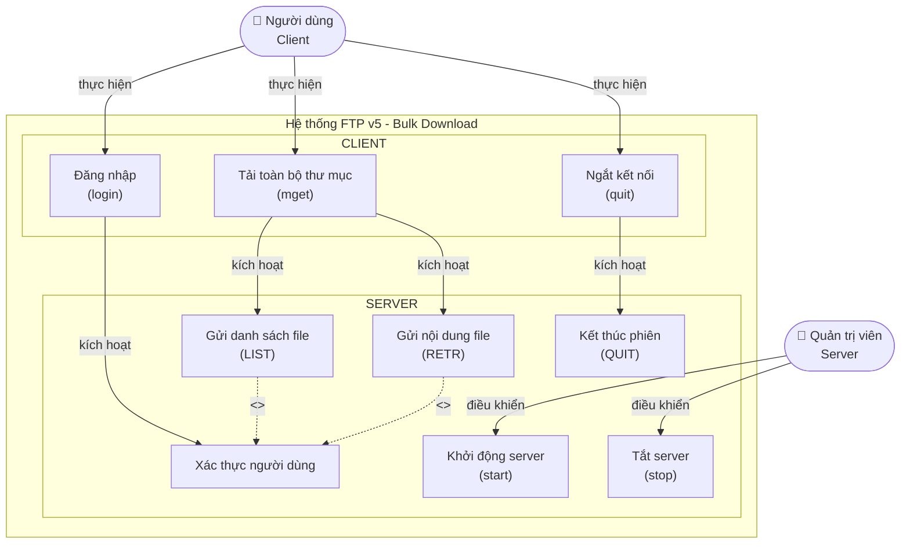
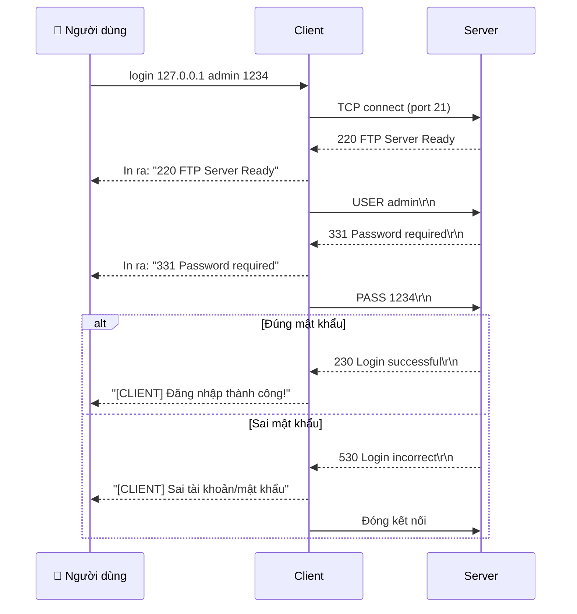
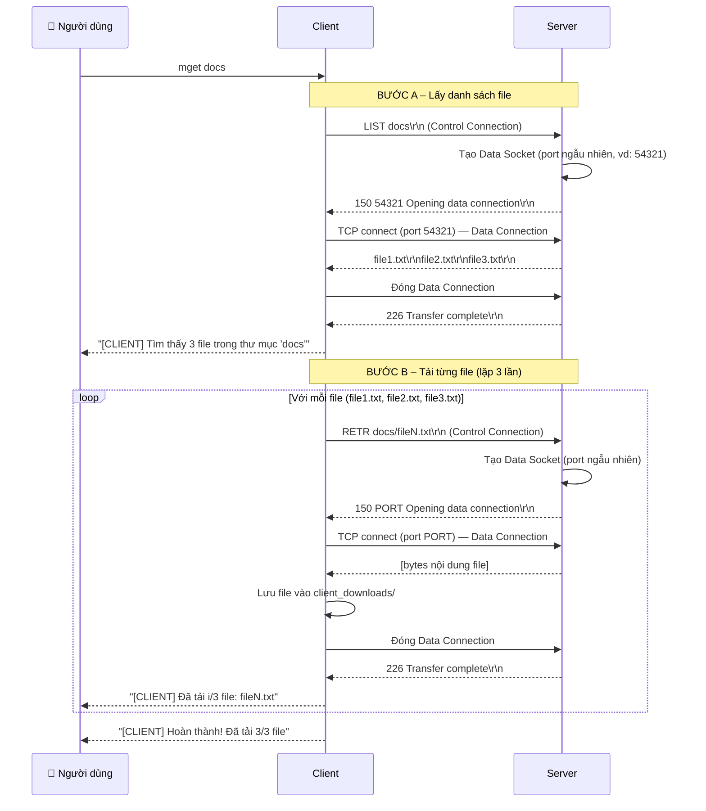
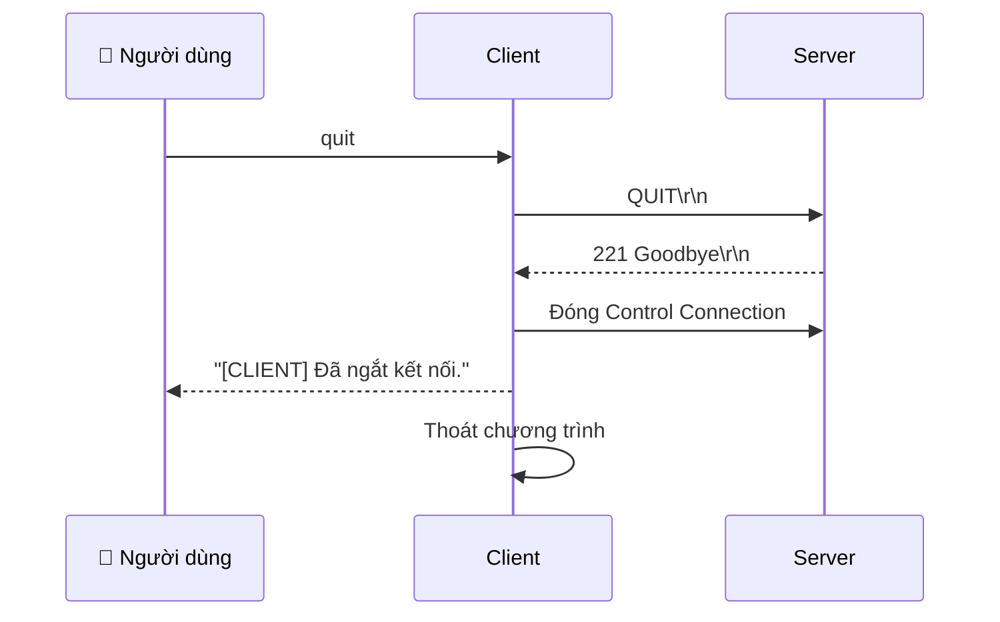
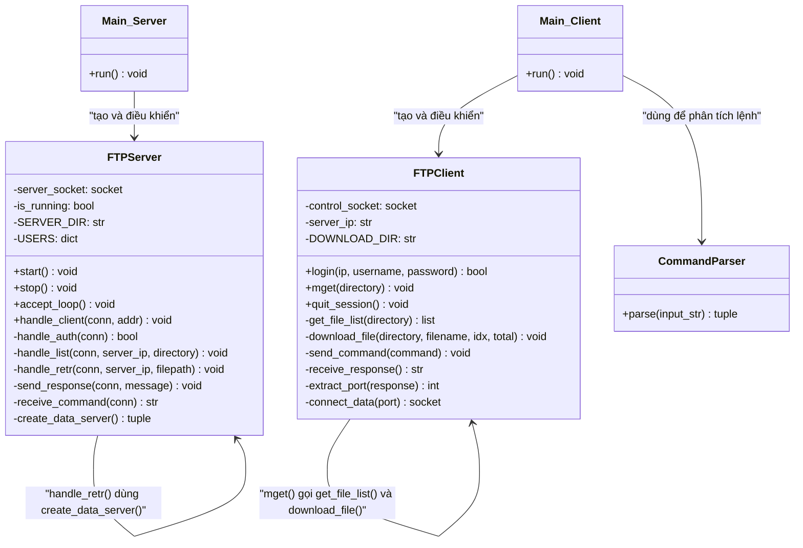
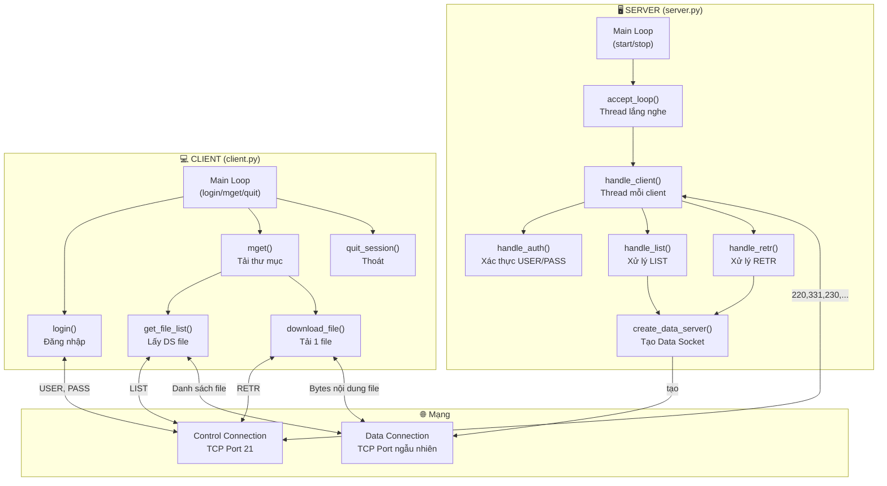

# BÁO CÁO ĐỒ ÁN: ĐỀ TÀI 13 – FTP v5 (TẢI TOÀN BỘ THƯ MỤC – BULK DOWNLOAD)

> **Môn học:** Lập trình Hệ thống Mạng  
> **Công nghệ:** Python · TCP/IP Socket · Giao thức FTP (mô phỏng)

---

## CHƯƠNG 1: PHÁT BIỂU BÀI TOÁN

### 1.1 Mô tả yêu cầu chính

Xây dựng ứng dụng **Client–Server** mô phỏng giao thức FTP phiên bản 5 (FTP v5), cho phép client **tải về toàn bộ các file** bên trong một thư mục chỉ định từ server bằng giao thức FTP.

Điểm đặc trưng của FTP v5 (Bulk Download) so với các phiên bản trước:

| Phiên bản | Đặc điểm |
|---|---|
| FTP v3 | Client gửi từng file lên server (bulk upload) |
| **FTP v5** | **Client tải toàn bộ thư mục từ server về (bulk download)** |

Sau khi đăng nhập, người dùng chỉ cần chỉ định **một tên thư mục** trên server. Client sẽ:
1. Tự động lấy danh sách file trong thư mục đó
2. Lặp qua từng file và tự động gửi yêu cầu download
3. Lưu về thư mục mặc định trên máy client
4. Hiển thị tiến trình tải

### 1.2 Các chức năng sẽ xây dựng

| # | Chức năng | Phía |
|---|---|---|
| 1 | Khởi động server, lắng nghe kết nối | Server |
| 2 | Tắt server | Server |
| 3 | Đăng nhập (xác thực tài khoản) | Client |
| 4 | Lấy danh sách file trong thư mục từ server | Client |
| 5 | Tải toàn bộ file trong thư mục về máy client (mget) | Client |
| 6 | Hiển thị tiến trình tải từng file | Client |
| 7 | Kết thúc phiên làm việc | Client |

### 1.3 Các lệnh hoạt động

**Phía Server:**
- `start` – Khởi động server, lắng nghe kết nối trên cổng **21**
- `stop` – Tắt server

**Phía Client:**
- `login <IP server> <username> <password>` – Kết nối và đăng nhập theo giao thức FTP
- `mget <tên thư mục server>` – Lấy danh sách file và tải toàn bộ về máy
- `quit` – Kết thúc phiên làm việc, đóng kết nối

---

## CHƯƠNG 2: MÔ TẢ SƠ BỘ GIAO THỨC FTP

### 2.1 Kiến trúc giao thức FTP

Giao thức FTP (File Transfer Protocol – RFC 959) sử dụng **hai kết nối TCP riêng biệt**:

```
┌─────────────────────────────────────────────────────────────┐
│                    KIẾN TRÚC FTP                            │
│                                                             │
│   CLIENT                           SERVER                   │
│   ┌──────┐                         ┌──────┐                 │
│   │      │◄── Control Connection ──►│      │ Port 21         │
│   │      │     (Gửi lệnh/phản hồi) │      │                 │
│   │      │                         │      │                 │
│   │      │◄══ Data Connection ═════►│      │ Port ngẫu nhiên │
│   │      │     (Truyền file/data)   │      │                 │
│   └──────┘                         └──────┘                 │
└─────────────────────────────────────────────────────────────┘
```

#### 2.1.1 Control Connection (Kết nối điều khiển)
- Sử dụng **cổng 21** cố định
- Tồn tại suốt phiên làm việc
- Dùng để gửi lệnh (USER, PASS, LIST, RETR, QUIT) và nhận mã phản hồi
- Giao tiếp bằng **văn bản thuần (plain text)**, mỗi lệnh kết thúc bằng `\r\n`

#### 2.1.2 Data Connection (Kết nối dữ liệu)
- Được tạo mới cho **mỗi lần truyền dữ liệu** (mỗi lần LIST hoặc RETR)
- Sử dụng cổng **ngẫu nhiên** do server cấp, thông báo cho client qua Control Connection
- Đóng lại sau khi truyền xong dữ liệu
- Dùng để truyền **dữ liệu nhị phân (bytes)** của file

### 2.2 Mã phản hồi FTP sử dụng trong đề tài

| Mã | Ý nghĩa | Khi nào dùng |
|---|---|---|
| `220` | Service ready | Server gửi khi client vừa kết nối |
| `331` | Username OK, need password | Sau khi nhận lệnh USER |
| `230` | Login successful | Xác thực thành công |
| `530` | Login incorrect | Sai tài khoản/mật khẩu |
| `150 <PORT>` | Opening data connection | Báo cổng Data Connection |
| `226` | Transfer complete | Sau khi truyền xong dữ liệu |
| `550` | File/Directory not found | Thư mục/file không tồn tại |
| `221` | Goodbye | Phản hồi lệnh QUIT |

### 2.3 Luồng giao tiếp tổng thể (FTP v5 Bulk Download)

```
CLIENT                                          SERVER
  │                                               │
  │─── TCP connect ──────────────────────────────►│ (port 21)
  │◄── 220 FTP Server Ready ──────────────────────│
  │                                               │
  │─── USER admin ───────────────────────────────►│
  │◄── 331 Password required ─────────────────────│
  │─── PASS 1234 ────────────────────────────────►│
  │◄── 230 Login successful ──────────────────────│
  │                                               │
  │─── LIST docs ────────────────────────────────►│
  │◄── 150 54321 Opening data connection ─────────│
  │─── TCP connect ──────────────────────────────►│ (port 54321)
  │◄══ file1.txt\r\nfile2.txt\r\nfile3.txt\r\n ═══│ (Data Connection)
  │─── TCP close data connection ────────────────►│
  │◄── 226 Transfer complete ─────────────────────│
  │                                               │
  │─── RETR docs/file1.txt ──────────────────────►│
  │◄── 150 54322 Opening data connection ─────────│
  │─── TCP connect ──────────────────────────────►│ (port 54322)
  │◄══ [bytes of file1.txt] ═══════════════════════│ (Data Connection)
  │─── TCP close data connection ────────────────►│
  │◄── 226 Transfer complete ─────────────────────│
  │   (Hiển thị: "Đã tải 1/3 file...")            │
  │                                               │
  │  (lặp tương tự cho file2.txt, file3.txt)      │
  │                                               │
  │─── QUIT ─────────────────────────────────────►│
  │◄── 221 Goodbye ───────────────────────────────│
  │─── TCP close ────────────────────────────────►│
```

---

## CHƯƠNG 3: MÔ TẢ THIẾT KẾ CHƯƠNG TRÌNH

### 3.1 Biểu Đồ UseCase



**Mô tả các Use Case:**

| Use Case | Actor | Mô tả |
|---|---|---|
| **Khởi động server** | Quản trị viên | Mở socket, lắng nghe kết nối trên cổng 21 |
| **Tắt server** | Quản trị viên | Đóng socket, dừng server |
| **Xác thực người dùng** | Hệ thống | Kiểm tra username/password từ client |
| **Gửi danh sách file** | Hệ thống | Đọc thư mục, gửi tên các file qua Data Connection |
| **Gửi nội dung file** | Hệ thống | Đọc file, gửi bytes qua Data Connection |
| **Đăng nhập** | Người dùng | Gửi USER + PASS, nhận phản hồi xác thực |
| **Tải toàn bộ thư mục** | Người dùng | Gửi LIST → nhận danh sách → lặp RETR từng file |
| **Ngắt kết nối** | Người dùng | Gửi QUIT, đóng kết nối |

---

### 3.2 Biểu Đồ Sequence

#### 3.2.1 Sequence: Đăng nhập (login)



#### 3.2.2 Sequence: Tải toàn bộ thư mục (mget)



#### 3.2.3 Sequence: Kết thúc phiên (quit)



---

### 3.3 Biểu Đồ Class



**Mô tả các lớp:**

| Lớp | Trách nhiệm |
|---|---|
| `FTPServer` | Quản lý toàn bộ logic phía server: lắng nghe kết nối, xác thực, xử lý lệnh LIST và RETR |
| `FTPClient` | Quản lý toàn bộ logic phía client: đăng nhập, lấy danh sách file, tải file |
| `CommandParser` | Phân tích chuỗi lệnh người dùng nhập vào thành tên lệnh và tham số |
| `Main_Server` | Vòng lặp chính của server, xử lý lệnh `start`/`stop` từ quản trị viên |
| `Main_Client` | Vòng lặp chính của client, xử lý lệnh `login`/`mget`/`quit` từ người dùng |

---

## CHƯƠNG 4: MÔ TẢ CHI TIẾT CÁCH LẬP TRÌNH

### 4.1 Cơ chế giao tiếp Control Connection

Tất cả lệnh và phản hồi qua Control Connection đều là **chuỗi văn bản UTF-8**, kết thúc bằng `\r\n` (theo chuẩn FTP – RFC 959):

```python
# Gửi lệnh/phản hồi (luôn kết thúc bằng \r\n)
def send_response(sock, message):
    # Mã hóa chuỗi thành bytes và gửi đi
    sock.sendall((message + "\r\n").encode("utf-8"))

# Nhận lệnh/phản hồi (đọc từng byte cho đến khi gặp \r\n)
def receive_command(sock):
    data = b""
    while not data.endswith(b"\r\n"):
        byte = sock.recv(1)   # đọc 1 byte mỗi lần
        if not byte:
            break             # kết nối đứt thì thoát
        data += byte
    return data.decode("utf-8").strip()  # bỏ \r\n ở cuối
```

**Lý do đọc từng byte:** Đảm bảo không bao giờ đọc "thừa" sang lệnh tiếp theo, giúp phân tách đúng các lệnh trên Control Connection.

### 4.2 Cơ chế Data Connection (Passive Mode đơn giản)

Mỗi lần cần truyền dữ liệu (LIST hoặc RETR), server tạo một socket tạm thời:

```python
# Phía SERVER: tạo data server socket
def create_data_server():
    data_server = socket.socket(socket.AF_INET, socket.SOCK_STREAM)
    data_server.bind(("", 0))     # bind port 0 = hệ điều hành tự cấp cổng trống
    data_server.listen(1)
    port = data_server.getsockname()[1]   # lấy cổng được cấp
    return data_server, port
    # → Ví dụ: trả về (socket_object, 54321)

# Phía CLIENT: kết nối vào cổng đó
def connect_data(server_ip, port):
    data_sock = socket.socket(socket.AF_INET, socket.SOCK_STREAM)
    data_sock.connect((server_ip, port))
    return data_sock
```

**Quy trình phối hợp:**
1. Server tạo `data_server`, lấy `port`
2. Server gửi `150 <port> ...` qua Control Connection
3. Client nhận phản hồi, trích xuất `port`
4. Client gọi `connect_data(server_ip, port)` → kết nối Data Connection
5. Server gọi `data_server.accept()` → chấp nhận kết nối
6. Truyền dữ liệu xong → cả hai bên đóng Data Connection
7. Server gửi `226 Transfer complete` qua Control Connection

### 4.3 Xử lý lệnh LIST (server gửi danh sách file)

```python
def handle_list(conn, server_ip, directory):
    # 1. Xây dựng đường dẫn thực của thư mục trên server
    dir_path = os.path.join("server_files", directory)

    # 2. Kiểm tra thư mục có tồn tại không
    if not os.path.isdir(dir_path):
        send_response(conn, "550 Directory not found")
        return

    # 3. Lấy danh sách tên file (chỉ lấy file, không lấy thư mục con)
    file_list = [f for f in os.listdir(dir_path)
                 if os.path.isfile(os.path.join(dir_path, f))]

    # 4. Tạo Data Connection
    data_server, port = create_data_server()
    send_response(conn, f"150 {port} Opening data connection")

    # 5. Accept kết nối từ client
    data_conn, _ = data_server.accept()

    # 6. Gửi danh sách file (mỗi file 1 dòng \r\n)
    file_names = "\r\n".join(file_list) + "\r\n"
    data_conn.sendall(file_names.encode("utf-8"))

    # 7. Đóng Data Connection, thông báo xong
    data_conn.close()
    data_server.close()
    send_response(conn, "226 Transfer complete")
```

### 4.4 Xử lý lệnh RETR (server gửi nội dung file)

```python
def handle_retr(conn, server_ip, filepath):
    # 1. Xây dựng đường dẫn thực của file trên server
    full_path = os.path.join("server_files", filepath)

    # 2. Kiểm tra file có tồn tại không
    if not os.path.isfile(full_path):
        send_response(conn, "550 File not found")
        return

    # 3. Tạo Data Connection
    data_server, port = create_data_server()
    send_response(conn, f"150 {port} Opening data connection")

    # 4. Accept kết nối từ client
    data_conn, _ = data_server.accept()

    # 5. Đọc và gửi nội dung file dưới dạng bytes
    with open(full_path, "rb") as f:
        data_conn.sendfile(f)    # gửi hiệu quả, hỗ trợ file lớn

    # 6. Đóng Data Connection, thông báo xong
    data_conn.close()
    data_server.close()
    send_response(conn, "226 Transfer complete")
```

### 4.5 Xử lý lệnh mget phía Client (tải toàn bộ thư mục)

```python
def mget(directory):
    # ═══ BƯỚC A: Lấy danh sách file ═══
    send_command(f"LIST {directory}")
    response = receive_response()       # nhận "150 <PORT> ..."

    if response.startswith("550"):      # thư mục không tồn tại
        print(f"Lỗi: {response}")
        return

    # Trích xuất cổng Data Connection từ chuỗi "150 54321 ..."
    port = int(response.split()[1])     # split → ["150","54321","Opening",...] → lấy [1]

    # Kết nối Data Connection để nhận danh sách file
    data_sock = connect_data(server_ip, port)
    raw_data = b""
    while True:
        chunk = data_sock.recv(4096)    # nhận từng 4KB
        if not chunk:
            break
        raw_data += chunk
    data_sock.close()

    receive_response()                  # nhận "226 Transfer complete"

    # Tách chuỗi nhận được thành danh sách tên file
    file_list = [f for f in raw_data.decode("utf-8").split("\r\n") if f]
    total = len(file_list)
    print(f"[CLIENT] Tìm thấy {total} file trong thư mục '{directory}'")

    # ═══ BƯỚC B: Tải từng file ═══
    for idx, filename in enumerate(file_list, start=1):
        # Gửi yêu cầu tải file
        send_command(f"RETR {directory}/{filename}")
        response = receive_response()   # nhận "150 <PORT> ..."

        port = int(response.split()[1])

        # Kết nối Data Connection để nhận nội dung file
        data_sock = connect_data(server_ip, port)
        file_data = b""
        while True:
            chunk = data_sock.recv(4096)
            if not chunk:
                break
            file_data += chunk
        data_sock.close()

        receive_response()              # nhận "226 Transfer complete"

        # Lưu file về thư mục client_downloads/
        save_path = os.path.join("client_downloads", filename)
        with open(save_path, "wb") as f:
            f.write(file_data)

        print(f"[CLIENT] Đã tải {idx}/{total} file: {filename}")

    print(f"[CLIENT] Hoàn thành! Đã tải {total}/{total} file về 'client_downloads/'")
```

### 4.6 Xử lý đa luồng phía Server

Server dùng **threading** để phục vụ nhiều client cùng lúc mà không bị block:

```python
import threading

def accept_loop(server_socket):
    """Vòng lặp chấp nhận kết nối client, chạy trong thread riêng"""
    while is_running:
        try:
            conn, addr = server_socket.accept()
            print(f"[SERVER] Client {addr[0]}:{addr[1]} đã kết nối")
            # Tạo thread riêng để xử lý từng client
            client_thread = threading.Thread(
                target=handle_client,
                args=(conn, addr)
            )
            client_thread.daemon = True   # thread tự tắt khi server tắt
            client_thread.start()
        except OSError:
            break    # socket đóng → thoát vòng lặp
```

---

## CHƯƠNG 5: TỔNG KẾT

### 5.1 Sơ đồ kiến trúc tổng thể



### 5.2 Điểm tuân thủ giao thức FTP

| Điểm | Cách thực hiện |
|---|---|
| **Hai kết nối riêng biệt** | Control (port 21) + Data (port ngẫu nhiên) |
| **Mã phản hồi 3 chữ số** | 220, 331, 230, 530, 150, 226, 550, 221 |
| **Lệnh kết thúc \r\n** | `sock.sendall((cmd + "\r\n").encode())` |
| **Passive mode** | Server tạo Data Socket, báo port cho client |
| **Binary mode** | Truyền file bằng bytes (`"rb"` / `"wb"`) |
| **Đa kết nối** | Mỗi client một thread riêng |

---

*Tài liệu phân tích thiết kế – Đề tài 13: FTP v5 (Bulk Download)*  
*Môn: Lập trình Hệ thống Mạng*
